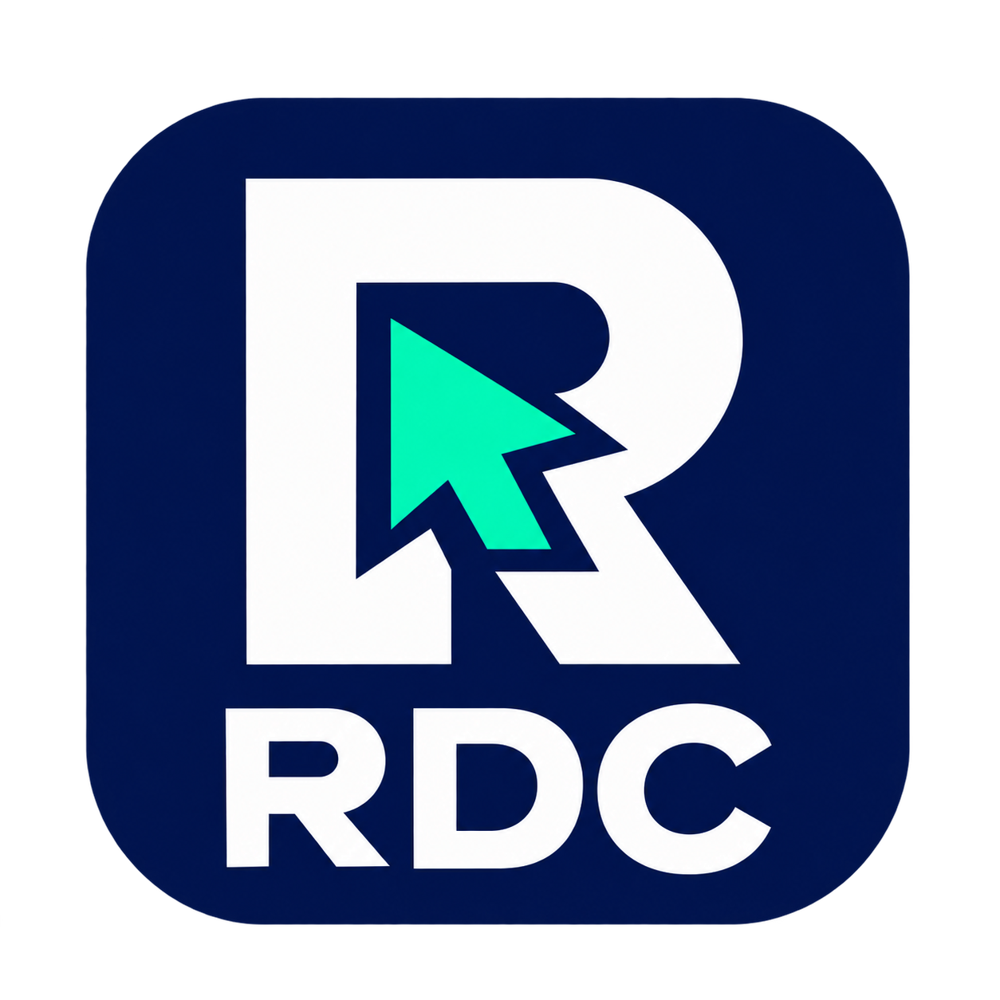

# RDC (Remote Desktop Commander)



**Independent agent workspaces with a live preview inside your AI app.**

RDC (Remote Desktop Commander) is an independent TOC Ministries project: a free, MIT-licensed local worker for self-hosted use with compatible MCP clients. It provides scoped file operations, durable terminal jobs, independent browser sessions, an embedded live preview in hosts that support MCP Apps, and owner-controlled approvals, pause, and saved-password consent. Optional native desktop and Android ADB tools require owner configuration; Android, iPhone, and iPad Appium adapters also require a prepared device or simulator, UiAutomator2 or XCUITest, and a compatible driver host. Preview modes depend on the AI host, and native mobile input uses the selected device's screen. The owner dashboard manages approvals, permissions, and takeover.

The local worker requires no RDC account, subscription, hosted service, telemetry, or model API key. Optional gateway hosting and your AI provider have their own terms and costs. This repository contains no Desktop Commander proprietary service code or assets.

**Independent RDC V2 gateway:** RDC also supports a portable standalone, single-operator gateway with private SQLite journaling and a persistent authenticated WebSocket, usable on your own VPS without ChatGPT Sites or any publisher computer. The operator's own device executes tools; the VPS is only the relay. See [self-hosted gateway setup](docs/RDC-STANDALONE-VPS-SETUP-20261120.md) and [public open-source deployment boundaries](docs/RDC-PUBLIC-OPEN-SOURCE-TOPOLOGY-20261120.md). Hosted multi-user OAuth is still under development.

**Mandatory RDC release gate:** five live latency targets plus 30+ correct matched terminal calls demonstrating at least 2x end-to-end speed over Desktop Commander. The standalone gateway additionally needs public TLS/WSS, owner/device pairing, deployed source and protected rollback verification. Synthetic or SSH-tunnel-only timings are not ChatGPT-hosted acceptance evidence.

**RDC 2.0 developer speed policy:** the direct, single-owner workflow replaces retired Atlas Bus orchestration. Run `python3 scripts/rdc_speed_first.py status` to inspect the source, `python3 scripts/rdc_speed_first.py test` for the capped 100-case regression, and `python3 scripts/rdc_speed_first.py gate --receipt /path/to/authenticated-live-receipt.json` for fail-closed speed acceptance. See [the speed-first workflow](docs/RDC-DIRECT-SPEED-WORKFLOW-20261120.md). This process never deploys the private Site or changes the installed worker.

**Preview v7 repair on the 0.1.0a8 production baseline.** Each view is bound to this chat's exact browser/device/native-window session. It shows the live image, cursor when available and viewer controls only. No desktop fallback, dashboard, jobs or session picker. Hiding or closing leaves work running. The resource is `ui://rdc/preview-v7.html`; published v1–v6 aliases remain readable. Native Mac capture works without activating the window; resizing requires the owner's Accessibility grant. [Guided macOS setup](docs/MACOS-SETUP.md) checks the separate RDC Window Preview helper. Shared native input requires owner approval even in trusted mode.

OpenAI's current MCP extension supports inline/fullscreen, not the built-in floating computer-use viewer. RDC now requests inline by default to avoid opening the tall side panel automatically; hosts still control presentation. Outer App branding and separate-chat ChatGPT web acceptance remain distinct checks. See [host contracts](docs/EMBEDDED-HOSTS.md).

**Historical 0.1.0a6 verification.** This release improves preview connection recovery and the private gateway's opening response. A mounted view offers explicit retry after a failed host handshake or an authorized offline/busy response. It retains the selected session and original pending operation, and rejects older responses that could erase a newer availability notice. The gateway queues an online open once and immediately returns its recovery reference. **28 focused UI/tool contracts and 19 gateway contracts passed without skips.** The advertised resource is `ui://rdc/preview-v2.html`, with the published v1 URI retained for compatibility. The owner-private gateway deployment succeeded, and live opens, original-operation recovery and a synthetic browser image were verified separately. Actual ChatGPT rendering remains unobserved at this checkpoint; the local Sites preview relay was unavailable. Read the [alpha.6 verification and limits](docs/VERIFICATION.md#alpha6-preview-reliability) before treating source checks as host acceptance.

**Historical 0.1.0a5 verification.** The frozen macOS gate passed **256 tests in 106.095 seconds**, with no failures, errors, skips or ResourceWarning lines. The matching runtime was installed and its 52 source inputs were independently verified. This repair keeps the owned-child wait reachable after a termination-backend error and extends the credential dashboard's busy state to grant and decision controls. The a4 private diagnostics, mobile adapters and CRLF fixture correction are preserved. The matching private gateway and plugin **1.0.6** were verified separately. The public release matched all **226 reviewed files** exactly, and its [hosted workflow](https://github.com/TOC-CS/RDC/actions/runs/43707243784) passed on Linux, macOS and Windows: 256 tests on Linux and macOS, and 239 executed tests plus 17 explicit platform skips on Windows. All three test suites recorded zero ResourceWarning lines. Read [verification](docs/VERIFICATION.md), the [audit](docs/AUDIT-2026-11-15.md), [diagnostic limits](docs/DIAGNOSTICS.md), and [mobile setup](docs/MOBILE.md) for executed evidence. Physical devices, native credential providers, production AI-host rendering, native desktop streaming, automatic Mac/Windows VM provisioning, and public ChatGPT web OAuth onboarding retain separate qualification or implementation work. [Platform details](docs/platforms.md).

## What works

- A self-contained MCP Apps view of the selected live session, with its agent cursor and host display controls. Hiding and reopening the view leaves the work running.
- A shared HTTP worker and a stdio bridge let ChatGPT/Codex, Claude configurations, and the owner preview use the same browser sessions. Disconnecting the bridge leaves the worker and its sessions running.
- Independent Playwright Chromium, Firefox, and WebKit contexts. Actual Safari uses configured W3C WebDriver. WebKit is not Safari.
- Browser text and control observations, fill/click, viewport pointer and keyboard input, navigation, image capture, and session cleanup. Screenshots use MCP image blocks instead of duplicating base64 into model text.
- Durable command jobs with stable IDs, persistent exit status, retained stdout/stderr, deterministic byte offsets, interactive stdin, timeout, cancellation, and duplicate-start prevention through retry keys.
- Bounded file listing/search, independent bulk reads, atomic UTF-8 writes, exact edits, hash preconditions, and consistent `file_path` arguments.
- Persisted owner review and a pause gate. An agent token cannot call owner API routes. Grants are configured by the owner, outside the MCP catalog.
- A private credential broker with opaque saved-password aliases, owner Allow Once / Always Allow for this site / Deny, and revocation. Passwords go through a private browser fill path; native Keychain or device authentication remains under the operating system's control. [Setup and limits](docs/CREDENTIALS.md).
- An optional outbound device relay for the companion private ChatGPT Sites gateway. It retains request/result state, verifies exact request hashes, and recovers pending results without automatically replaying uncertain actions.
- Private, bounded incident capture for guarded worker failures and relay outcomes, with a read-only report through `rdc_diagnostics_status` or `rdc diagnostics`. Supported POSIX runtimes capture predefined categories without arguments, raw errors, paths or credentials. Windows capture reports unavailable while worker and relay operations continue. [Diagnostics and recovery](docs/DIAGNOSTICS.md).
- Optional PyAutoGUI desktop and authorized Android ADB routes, including Android swipe, long press and explicit activity launch. These require OS permissions and device setup. A native screenshot includes the scaling between captured image and logical input coordinates.
- Owner-configured Appium sessions for Android through UiAutomator2 and iPhone/iPad through XCUITest. Observe native controls, tap, fill nonsecure fields, swipe, and view privacy-checked screenshots in the existing preview. Physical-device input uses that device's screen; use a separate emulator, simulator or dedicated device for independent work. See [mobile setup](docs/MOBILE.md).

## Quick start

Use Python 3.11 or newer. From this source checkout:

```sh
python3 -m venv .venv
.venv/bin/python -m pip install '.[browser]'
.venv/bin/python -m playwright install chromium
.venv/bin/rdc init --root /absolute/path/to/your/workspace
.venv/bin/rdc serve
```

On Windows use `.venv\Scripts\python.exe` and `.venv\Scripts\rdc.exe`, and a Windows path for `--root`. `python` can replace `python3` where appropriate. Firefox and WebKit browser runtimes are installed separately with `python -m playwright install firefox webkit`.

Initialization defaults to owner review, file operations within the working root, no shell execution, and native desktop input disabled. To grant terminal execution at initialization, add `--allow-exec`. To explicitly grant file access across the host, add `--access-mode full-host`. The account's ordinary OS permissions still apply. To permit agent mutations without per-operation review on a trusted dedicated worker, add `--approval-mode trusted`. Existing initialization is preserved; grants can be edited in its private `config.json` while the service is stopped.

Connect your AI client as described below and ask it to open the RDC preview. For owner administration, open `http://127.0.0.1:8765/`. Run `rdc owner-token` in your own terminal and paste that credential into the administration page. The page retains it only in memory. It is separate from `agent-token`; do not send either credential to an AI conversation. `rdc doctor` reports dependencies and selected capabilities without printing tokens.

Default state directory:

| System | Directory |
|---|---|
| macOS | `~/Library/Application Support/RDC` |
| Windows | `%LOCALAPPDATA%\RDC` |
| Linux | `$XDG_STATE_HOME/rdc` or `~/.local/state/rdc` |

Every command accepts `--state-dir` for a separate worker/profile. Token files are restricted on POSIX. Windows relies on the account profile and deployment ACLs; dedicated Windows ACL hardening remains a release qualification item.

## Connect AI clients to the shared worker

Start `rdc serve` once. Then configure your client to run:

```sh
/absolute/path/to/.venv/bin/rdc connect --url http://127.0.0.1:8765/mcp
```

Add the matching `--state-dir` if the worker uses a custom state directory. `connect` reads the private agent credential locally and forwards tools and UI resources through the official MCP transport. It never receives the owner credential and never closes the worker on disconnect. A reconnected preview attaches to the same active browser session.

Use the ready examples for [Codex](examples/client-codex.toml), [Claude Desktop](examples/client-claude-desktop.json), or [direct HTTP](examples/client-http.py). They contain placeholders for your installation paths. A model can use RDC when its host supports the relevant MCP transport. Client permissions, tool approvals, image support, and context limits still apply.

`rdc stdio` also runs a standalone worker inside one client's process. Its browser sessions end when that process exits and are separate from a separately launched dashboard. Choose `connect` to retain the worker while each chat keeps its own preview source.

### Private ChatGPT web gateway

The companion [RDC ChatGPT gateway](cloud-gateway/README.md) supplies a private Sites MCP route. A device-side `rdc relay` process makes outbound HTTPS connections to that gateway and invokes the existing loopback worker with its agent credential. This route keeps the worker's listener and owner administration local. It requires a private deployed Site, its supported ChatGPT connection, and an owner-created pairing configuration. The public multiuser OAuth onboarding flow remains unfinished. [Installation details](docs/PLUGIN-INSTALL.md#chatgpt-web-and-remote-clients).

Run the relay alongside the worker, selecting its matching private state:

```sh
rdc relay --config /absolute/path/to/private/relay-config.json
```

The alpha.7 local catalog contains **53 tools**. The gateway adds `rdc_connection_status` and `rdc_operation_status`, for **55 tools** when its bundled catalog matches this version. `rdc_preview_frame` and `rdc_preview_activity` are app-only observers. Gateway source deployment and actual rendering inside ChatGPT are separate acceptance checks. An embedded component, a registered route, or a logo asset alone does not establish that the production AI host renders RDC's preview or tool identity.

The **0.1.0a5** installation was verified separately from its frozen test gate: all 52 live source hashes matched, the complete previous runtime backup matched its inventory, and protected state was preserved. The matching owner-private gateway passed nine tests, TypeScript checking and its production build, then reached terminal deployment success with MCP enabled. Private plugin **1.0.6** passed exact nine-file readback while preserving its App binding, presentation and private audience. Native worker status reported a5, and the diagnostic tool returned an available, ready report with `incomplete: false`. The independent guardian remains undeployed. The concurrent public follow-up records an unresolved "App unavailable" preview; the current release checks do not establish that rendering was repaired. The requested publisher and icon changes, production embedded rendering and an owner-approved live cloud browser workflow remain separate checks. See the [audit evidence](docs/AUDIT-2026-11-15.md#current-chatgpt-connection).

The local stdio package still works without a relay. Hosted clients need a reachable authenticated route; their `127.0.0.1` does not point to the user's computer. Direct HTTP clients that support the worker's bearer authentication can use an appropriately secured endpoint.

The last coordinated a5 host check exposed **53 model-visible tools**, including mobile and diagnostics, matching the 54-tool server catalog with app-only `rdc_preview_frame`. The earlier 41-tool snapshot is historical. Follow the actual tool schemas, including advertised account routing such as `link_id`, and retain the same account through operation recovery. Native mobile listing succeeded with no configured profiles or sessions; tool discovery does not qualify a phone workflow. Catalog freshness and embedded rendering each need their own observation.

### Preview window behavior

Call `rdc_preview_open` with the `session_id` of the RDC browser or configured device that is doing the work. The host opens one live view for that source. The view displays frames and the agent cursor when available. A missing or ended source stays empty until the task opens a specific new source. Terminal output, session discovery, and approvals use their own tools.

Hiding, closing, and reopening the view affects observation only. The same browser and jobs continue. The AI host controls panel sizing, expansion, and floating, and may decline a mode request. A tool response alone does not confirm that a host rendered the preview. See [host contracts](docs/EMBEDDED-HOSTS.md) and [real-host acceptance](docs/ACCEPTANCE.md).

The committed bundle runs without Node, a CDN, or direct network access from the iframe. To update it, run `npm ci --ignore-scripts` and `npm run build` in `rdc/embedded`, then sync the gateway assets with `cloud-gateway/scripts/sync-rdc-assets.py`. The view can recover the original pending open or frame and request a new read of the same source once expiry is confirmed.

## Work without taking over the owner's desktop

| Task | Execution area | Interference |
|---|---|---|
| Browser automation | Dedicated headless browser contexts | Separate browser input and profiles; shares CPU/RAM/network |
| Terminal jobs | Detached worker processes | No pointer use; commands may affect files/apps according to grants |
| Native apps with `shared` mode | Current desktop | Uses that desktop's cursor/focus |
| Native apps with `isolated` mode | Owner-provisioned separate desktop/display/VM | Independent only when that environment is actually separate |
| Phone dashboard | A mobile browser viewing the worker | Does not grant control of the phone OS |

A second window alone cannot create a second OS cursor. RDC's `isolated` setting describes the environment the owner must provision; it does not create a VM. The [optional Linux container recipe](deploy/README.md) provides a private Xvfb display, but its image and native input path still need deployment qualification. Containers share a host kernel; use a VM where that distinction matters.

The owner takeover control pauses new agent mutations, then directs preview clicks to the browser worker. Actions already admitted may finish. Existing background jobs keep running and can be cancelled individually. Human activity, native app services, and other clients outside RDC are not frozen.

## Operating contracts

File read offsets and command output offsets are **bytes**. Zero always means the beginning. Text decoding uses UTF-8 with replacement for split or invalid sequences; retrieve source files directly for binary fidelity. File writes are capped by the configured text limit. Larger/binary transformations can use authorized jobs. Hash checks coordinate RDC writers and detect changed content; they do not create a filesystem transaction with unrelated applications.

Command `argv` is passed without shell expansion. Use an explicit shell when a command requires shell syntax. Start returns immediately with a durable job ID. Save that ID and retry key. Reusing a key with the same normalized command retrieves the original job; changing arguments conflicts. A dropped tool response never justifies blindly replaying a mutation. The bridge preserves complete protocol rejections and remains usable for later calls. A timeout or lost connection still latches an uncertain failure and requires inspection before reconnecting.

Interactive stdin delivery accounts for partial pipe writes before marking queued input delivered. A stalled or broken input stream records an incomplete-input failure, even when the child exits zero; partially delivered input is never replayed automatically. Inspect both job status and its error field when recovering a command.

Logs merge stdout/stderr in arrival order and are capped at 10 MiB per job by default. The worker keeps draining excess output and records truncation. Metadata and retained output remain in the state directory until the owner removes them; there is no automatic retention cleanup or global disk quota in this alpha. A lost worker heartbeat after two minutes is marked interrupted, never assumed completed. A machine restart may terminate running processes. Browser sessions are memory-resident and end with the daemon.

Owner review lasts 15 minutes and persists across a client restart. A request already executing at daemon failure requires investigation; it is not automatically replayed. The dashboard displays the exact action being approved. Read files again after a hash conflict and observe the page again after a stale handle.

Cloud mutations require a stable `_rdc_request_id`. Keep that ID and the original arguments after a dropped response. A pending gateway response supplies an `operation_id`; call `rdc_operation_status` with it to retrieve the original result without issuing the action again. Core job retry keys and credential `idempotency_key` values remain separate from this transport request ID. The relay journals admission before execution and retains results before upload. An execution whose outcome is unknown after a crash is reported as uncertain and requires inspection.

If the authenticated gateway no longer retains an operation's identity, the relay records its result as `undeliverable` locally and continues with unrelated work. That state never claims a successful upload or permits execution again. The original request/result remain subject to the local payload retention bound; an identity record remains after payload pruning. Inspect the worker before another attempt, and preserve the relay journal.

Browser observations export at most 150 control handles and 24,000 characters of page text. They report `text_truncated`, `controls_truncated`, `control_scan_truncated` and per-control name/value truncation. Control selection uses a 5,000-element and 300-candidate scan budget; unused or failed handles are released. A truncated result may require another observation path or a narrower page state.

If WebDriver creates a session but later setup fails, RDC attempts to close that exact session. Unconfirmed cleanup leaves a discoverable session marked `cleanup_required`; close that session explicitly before starting a replacement. It accepts cleanup only. This recovery route still requires qualification on actual Safari and other configured drivers.

Empty relay polls gradually back off from 250 milliseconds to five seconds, using the longer of the gateway's bounded poll interval and the local delay. Receiving work immediately resets the local delay and the pump checks for more work after returning its result. At steady idle, each empty response is followed by a five-second delay; server-side long polling can reduce the request rate further. A newly queued task after a quiet period may incur up to five seconds of additional pickup delay, plus network time. Heartbeats during execution and operation-expiry checks remain separate.

### Private diagnostics and recovery

Use `rdc_diagnostics_status` with an optional `limit` from 1 to 50, or run `rdc diagnostics --state-dir /path/to/private/rdc-state --limit 20`. The report distinguishes connection interruptions, verified reconnection, retained result delivery, and unknown outcomes. Capture uses a queue of at most 256 entries and retains at most 2048 predefined events in a separate private store. Check `available`, `incomplete`, `storage_status` and the capture counters before relying on a report. Windows capture is unavailable in this release; a CLI history read cannot establish another process's live capture state.

The relay automatically reconnects transports and retries delivery of retained results under its existing rules. Uncertain actions remain protected from replay. Unknown code defects require reproduction, a reviewed repair, tests and activation of an approved version. The recorder neither generates repair code nor installs updates. See [the diagnostic contract](docs/DIAGNOSTICS.md) for finite data fields, bounded storage, dropped events and crash limits.

## Saved-password permissions

The owner enrolls an existing native credential in the owner administration page by supplying a safe alias, exact HTTPS origin and native item locator. macOS enrollment now requires the specific classic **Keychain file**, server and account. The private version-2 locator binds one HTTPS origin; older server/account-only aliases require removal and re-enrollment before filling. The form never asks for a password or enumerates the vault. It generates an opaque ID and writes the private `credential-locators.json`; advanced owners may edit that mapping privately. Enrollment does not authorize a fill or verify that the native entry exists. With no mapping file, this feature is simply unconfigured. The agent can list safe aliases, request a fill into a fresh observed password field, and inspect request status. It cannot enroll or remove credentials, approve a request, create a persistent grant, or revoke a grant through MCP.

The existing owner administration page automatically presents pending requests. **Allow Once** authorizes one attempt. **Always Allow for this site** binds the credential, origin, device and mapping until revoked. **Later** dismisses the prompt while work continues. The owner can revoke a grant or remove an alias there. The broker checks consent and pause again before native lookup and before input, and rechecks the actual browser origin, document and password-field type. The initial feature fills only the password field; it does not click Sign in. Revocation blocks future use and does not sign out an already authenticated website session.

The macOS helper opens only the selected classic Keychain, requires one matching internet-password item, checks its server/account/HTTPS/port metadata, and reads the password from that same retained item reference. Missing, ambiguous or mismatched items fail before a password read. Windows uses a configured generic Credential Manager target. These routes do not expose arbitrary Apple Passwords/iCloud or Chrome/Edge vault access. Browser-provider autofill and mobile credential adapters remain future work. The automated tests use synthetic credentials and native-API fixtures; actual native vault access still requires platform qualification. See [credential setup, APIs and security boundaries](docs/CREDENTIALS.md).

Observations keep broker-filled inputs redacted after a page's Show Password control changes their type. Playwright capture independently checks document sensitivity and masks every input in a document that received a broker credential, including other visible form inputs. Fresh nonsensitive documents return to normal password-field and private-marker masking. WebDriver screenshots fail closed for credential-sensitive documents until fresh nonsensitive navigation. Probe or masking failures return no image. The authorized website can still read its form values and copy them elsewhere. See the [privacy limits](docs/CREDENTIALS.md#security-and-practical-limits).

## Permissions and security

Read [SECURITY.md](SECURITY.md) before exposing a worker outside your computer. File roots, schemas, review, and separate HTTP credentials prevent common mistakes. **An authorized shell runs as the worker OS account and can access that account's files, credentials, and configuration. These application checks are not an OS sandbox or a defense against that fully authorized account.** Separate identities, containers, or VMs supply stronger boundaries.

The service binds to loopback. Remote use needs a secured tunnel or authenticated HTTPS gateway, correct `allowed_origins`, and independent access controls. No unauthenticated public listener is provided. Browsing has the worker's network access, including local networks. Website text is untrusted task data, not authority to change grants, reveal secrets, or issue unrelated commands.

## Test and measure

For a guided run inside a real AI host, follow [client acceptance](docs/ACCEPTANCE.md). It covers the actual connection, independent browser, view lifecycle, durable jobs, credential consent and platform evidence.

```sh
.venv/bin/python -m pip install '.[browser,test,v2]'
.venv/bin/python -m playwright install chromium
.venv/bin/python scripts/rdc_test_budget.py --campaign local-core
.venv/bin/python scripts/benchmark.py --browser
```

**Testing cap:** The RDC owner has limited every RDC test campaign to **100 total test cases**, across all categories. The command above runs 86 Node V2 plus 14 Python checks, not the entire historical suite. The GitHub three-OS workflow shares 100 total tests across its jobs. Before running, review [the enforced RDC 100-check testing policy](docs/RDC-TEST-100-EXECUTION-POLICY.md). Unselected tests remain unverified and release gates stay open. Use the installed virtual environment. The managed system Python may contain an older incompatible MCP SDK. Hosted Linux, macOS and Windows results are recorded by exact revision in [verification](docs/VERIFICATION.md). Tests report unavailable browser runtimes as skips. macOS and Windows hardware and permission checks remain separate from protocol fixtures.

Benchmarks report local worker latency and call counts. They do not establish that RDC is faster than Codex or Desktop Commander. Comparable task success, recovery, total round trips, and end-to-end time are the intended performance measures.

## Project and contribution

See [design](docs/superpowers/specs/2026-11-15-rdc-design.md), [implementation plan](docs/superpowers/plans/2026-11-15-rdc-plan.md), [comparison](docs/COMPARISON.md), [TOC migration](docs/TOC-MIGRATION.md), [release verification](docs/VERIFICATION.md), and the [current audit and priorities](docs/AUDIT-2026-11-15.md). Contributions should include a reproducer and actual platform evidence. Use synthetic fixtures rather than personal credentials or production data.

Priority next work: public multiuser ChatGPT OAuth onboarding and production host acceptance, native desktop streaming and input handoff, browser tabs/popups/frames/download-upload workflows, actual Safari and native Windows qualification, native credential-provider qualification, mobile device qualification, and packaging/signing. See the platform matrix for precisely what is implemented.

